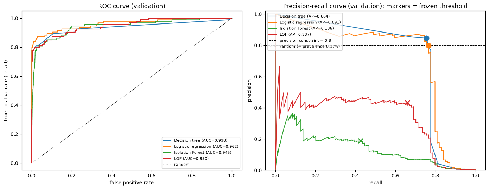

# Anomaly Detection: Fraud & Predictive Maintenance

This project compares supervised and unsupervised methods to detect rare events: credit card frauds and machine failures. The goal is to **catch as many anomalies as possible while keeping the alerts reliable** (at least 80 % correct alerts for fraud, 90 % for maintenance).

*Master's in Data Science, Machine Learning course project.*

Two notebooks:
- [fraud_detection.ipynb](notebooks/fraud_detection.ipynb): a short version focused on fraud detection, from the data to the final results.
- [anomaly_detection.ipynb](notebooks/anomaly_detection.ipynb): the full analysis, with all five parts.

## Main results

**Credit card fraud** (284,807 transactions, 0.17 % frauds). Results on the test set, which was used only once at the end:

| Method | Type | AP | Precision | Recall | Precision ≥ 80 % |
|---|---|---|---|---|---|
| **Weighted logistic regression** | supervised | **0.73** | **0.88** | **0.79** | Yes |
| Decision tree + SMOTE | supervised | 0.65 | 0.80 | 0.78 | Yes (just) |
| EasyEnsemble | supervised | 0.72 | 0.77 | 0.77 | No |
| LOF (k = 100) | unsupervised | 0.40 | 0.46 | 0.66 | No |
| Isolation Forest | unsupervised | 0.24 | 0.20 | 0.44 | No |

With the selected model, the fraud team would review **85 alerts out of 56,746 transactions: 75 are real frauds**, and 20 of the 95 frauds are missed.



Other findings:
- **ROC-AUC is not useful here**: all methods score between 0.94 and 0.96, while their AP goes from 0.14 to 0.69.
- **The threshold matters as much as the model**: default thresholds give between 600 and 4,200 alerts. The threshold is chosen on the validation set to meet the precision target.
- **Predictive maintenance (AI4I 2020)**: the same model meets the 90 % precision target but finds only 6 % of the failures. A linear model does not fit these failures well.
- **Explainability**: SHAP values on Isolation Forest show which features make a transaction look suspicious.

## Content

| Part | Dataset | Content |
|---|---|---|
| 1 | Mouse (2-D toy data) | Isolation Forest vs LOF, thresholds without labels (IQR), outlier vs novelty detection |
| 2 | [Credit Card Fraud](https://www.kaggle.com/datasets/mlg-ulb/creditcardfraud) | Decision tree, logistic regression (no correction / class weights / SMOTE), Isolation Forest, LOF: 24 configurations |
| 3 | Credit Card | EasyEnsemble, plus ECOD (coded from scratch) and Gaussian mixture |
| 4 | [AI4I 2020](https://archive.ics.uci.edu/dataset/601/ai4i+2020+predictive+maintenance+dataset) | Same methods applied to predictive maintenance |
| 5 | Mouse / Credit Card | Robustness to noisy training data, SHAP explanations |

**Method:** duplicates removed before splitting, stratified 60/20/20 split (train / validation / test), preprocessing and resampling fitted on the training set only, all choices made on the validation set, test set used once, fixed random seeds.

## Project structure

```
├── notebooks/
│   ├── fraud_detection.ipynb    # short version: fraud detection only
│   └── anomaly_detection.ipynb  # full analysis: all five parts
├── src/utils.py                 # all the code (data loading, models, metrics, thresholds, plots)
├── data/                        # mouse.txt, ai4i2020.csv (+ creditcard.csv, to download)
├── reports/summary.pdf          # 2-page written summary
└── requirements.txt
```

## How to run

```bash
python -m venv .venv && source .venv/bin/activate
pip install -r requirements.txt
# download creditcard.csv from Kaggle into data/ (144 MB, too large for GitHub)
jupyter notebook notebooks/fraud_detection.ipynb
```

**Tools:** Python, scikit-learn, imbalanced-learn, SHAP, pandas, NumPy, Matplotlib.
